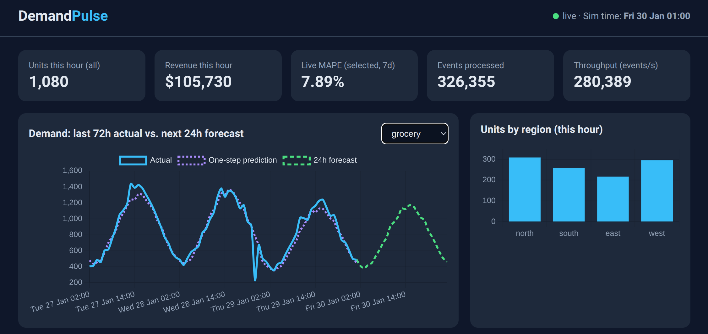

# DemandPulse: Real-Time Demand Forecasting & Anomaly Detection

A streaming analytics service that takes in a live stream of e-commerce order events, rolls them up into hourly demand per product category and region, forecasts the **next 24 hours**, and flags **demand spikes and drops** as they happen. Results stream to a live dashboard over WebSockets.

**Live demo:** https://demandpulse-ysvi.onrender.com  *(free tier: first load may take ~30s to wake up)*




## Architecture

```
 Order event stream ──► Aggregator ──► Anomaly detector ──► Forecaster ──► WebSocket ──► Dashboard
 (simulator, ~700        (hourly per    (rolling z-score    (DoW factors +   broadcast    (Chart.js)
  events / sim-hour)      category/      on forecast         robust Holt-
                          region)        residuals)          Winters, m=24)
```

- **Simulator** (`app/simulator.py`): Poisson order arrivals with daily and weekend seasonality, slow trend, and randomly injected anomalies (2.5× spikes and 0.3× drops) that serve as ground-truth labels.
- **Forecaster** (`app/forecaster.py`): Holt-Winters triple exponential smoothing written from scratch (no ML libraries). It uses multiplicative day-of-week factors on a daily-seasonal model, clips outliers so anomalies don't distort the state, and picks parameters by grid search. The model refits every 24 simulated hours.
- **Anomaly detector** (`app/anomaly.py`): computes a z-score of each one-step residual against a rolling 72-hour baseline. Flagged points are left out of the baseline so one spike can't hide the next.
- **Server** (`app/main.py`): FastAPI app with a background stream loop, `GET /api/state`, `GET /healthz`, and `WS /ws`.

## Benchmarks (reproducible: `python -m benchmarks.benchmark`)

Rolling-origin backtest: 28-day training window, 14-day test window, re-forecasting the next 24 hours each day.

| Metric | Result |
|---|---|
| 24h forecast MAPE (mean of 4 categories) | **10.26%** vs. 12.31% for the best seasonal-naive baseline (**16.6% lower error**) |
| Anomaly detection vs. injected ground truth | **100% precision, 91.3% recall** (21 TP / 0 FP / 2 FN) |
| End-to-end throughput, single process | **~200k events/sec** through aggregate → detect → forecast |

Full table: [`benchmarks/results.md`](benchmarks/results.md). Throughput depends on the machine.

## Model comparison study (`python -m benchmarks.compare_models`)

Same backtest setup (14 forecast origins × 4 categories, 24h MAPE on non-anomalous hours):

| Model | Mean 24h MAPE | Fit + forecast time |
|---|---|---|
| Naive (same hour last week) | 12.31% | ~0 ms |
| **Holt-Winters (DemandPulse, from scratch)** | 10.26% | **23 ms** |
| Prophet (Meta) | 9.92% | 206 ms |
| **LightGBM** (one global model, lag + calendar features) | **8.60%** | 164 ms |

**Takeaways**
- LightGBM is the most accurate model: **16% lower error than Holt-Winters**. One global model trained across all categories learns patterns they share, and lag features capture the weekly cycle directly.
- Holt-Winters is about **7–9× faster** and needs no ML dependencies. That's why the live service uses it: it refits online every simulated day within the tick budget.
- Prophet is only slightly better than Holt-Winters and is the slowest.
- Next step: serve LightGBM in the live loop with periodic offline retraining.

Full table: [`benchmarks/comparison.md`](benchmarks/comparison.md). Extra dependencies: `pip install -r requirements-bench.txt`.

> Data is synthetic and generated by the simulator, so the anomaly labels are known exactly. The pipeline is written so the simulator can be replaced with a Kafka or Pub/Sub consumer.

## Run locally

```bash
python -m venv .venv && source .venv/bin/activate
pip install -r requirements.txt
uvicorn app.main:app --reload        # open http://localhost:8000
python -m unittest discover -s tests -t .
python -m benchmarks.benchmark
```

Or with Docker: `docker build -t demandpulse . && docker run -p 8000:8000 demandpulse`

## Deploy (Render, free)

Push to GitHub → Render → **New → Blueprint** → select this repo (it reads `render.yaml`). The free tier sleeps when idle, so the first load can take about 30 seconds.

## Roadmap
- Replace the simulator with a Kafka or Redis Streams consumer
- Gemini-generated natural-language explanations of anomalies
- Prediction intervals and per-region forecasts

